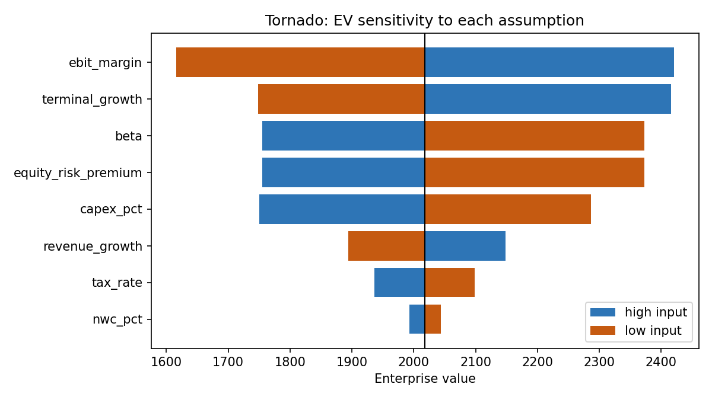

# DCF valuation with sensitivity analysis

A discounted-cash-flow model built the way a reviewer wants to check it: every
intermediate number is exposed, every assumption can be stressed, and the Excel
output uses live formulas that are verified against the Python model before
delivery.



## What it does

| Step | Module | Output |
|---|---|---|
| WACC build-up (CAPM cost of equity, after-tax cost of debt, target weights) | `dcf/model.py` | `wacc()` |
| 5-year FCFF projection from operating ratios | `dcf/model.py` | `outputs/cash_flows.csv` |
| Terminal value (Gordon growth), EV → equity → per-share bridge | `dcf/model.py` | `value()` |
| One-at-a-time sensitivity, ranked by swing | `dcf/analysis.py` | `outputs/tornado.csv`, `tornado.png` |
| Two-way table: WACC × terminal growth | `dcf/analysis.py` | `outputs/two_way_wacc_g.csv` |
| Monte Carlo on growth, margin, terminal growth and beta (n = 10 000) | `dcf/analysis.py` | `outputs/monte_carlo_summary.csv`, `monte_carlo.png` |
| Excel workbook with **live formulas**, recalculated and checked against Python | `dcf/excel.py` | `outputs/dcf_model.xlsx` |

## Run it

```bash
pip install -r requirements.txt
python run.py                  # base case in data/base_case.json
python -m pytest tests         # 7 tests: WACC by hand, FCFF identity, monotonicity, bridge, reproducibility
```

To value a real listed company, derive the operating ratios from its filings:

```bash
pip install yfinance
python scripts/fetch_financials.py SAP.DE > data/sap.json
python run.py data/sap.json
```

Market inputs (risk-free rate, equity risk premium, beta, cost of debt, target
leverage) are judgement calls and are deliberately not pulled automatically.

## Base case result

Illustrative mid-cap industrial, EUR millions (`data/base_case.json`):

```
WACC               7.21%
PV explicit        424.3
PV terminal value  1,593.7  (79% of EV)
Enterprise value   2,018.0
Equity value       1,668.0
Value per share    20.85
```

Two things a reviewer would flag immediately, and which the outputs make visible:

1. **79 % of EV sits in the terminal value.** The two-way table shows a ±1 pp
   move in WACC changes EV by roughly −16 % / +24 %; a ±0.5 pp move in terminal
   growth by about ±9 %. These two inputs deserve the most scrutiny.
2. **EBIT margin is the largest operating driver** (tornado), ahead of revenue
   growth. A 2 pp margin error moves EV by ~€800 m; a 2 pp growth error by ~€250 m.

The Monte Carlo gives a 90 % interval of roughly €1.4–2.8 bn around a median of
€2.0 bn, which is the honest answer to "what is this company worth?".

## Design choices

- **Model as pure functions over a frozen dataclass.** The same `value()` runs
  the base case, the sensitivity grid and 10 000 simulations. No state, no
  copy-paste between scenarios.
- **Excel mirrors Python cell by cell** with blue inputs and formula outputs,
  then `verify_against_python()` recalculates the workbook headlessly
  (LibreOffice) and asserts the enterprise value matches to 1e-6. The workbook
  is a deliverable, not a screenshot.
- **Invalid regions are explicit.** Where WACC ≤ g, the table shows a blank
  rather than a nonsense number, and Monte Carlo reports how many draws it
  dropped.
- **Mid-year convention** is a one-flag option; terminal value is always
  discounted from year N.

## Limitations

Single-stage growth in the explicit period; no explicit debt schedule or
interest tax shield beyond the WACC; no scenario-weighted terminal multiples.
Each is a small extension of `project_cash_flows()` or `value()`.

## Structure

```
dcf/            model.py (valuation) · analysis.py (sensitivity, Monte Carlo) · excel.py (workbook + verification)
data/           base_case.json
scripts/        fetch_financials.py (yfinance → case file)
tests/          test_model.py
run.py          end-to-end: prints the bridge and writes outputs/
```
